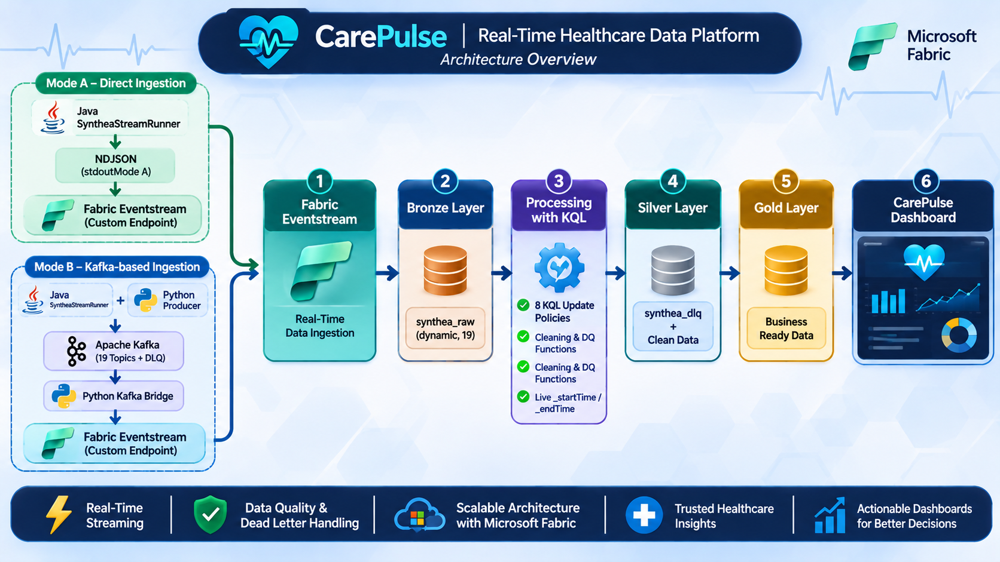
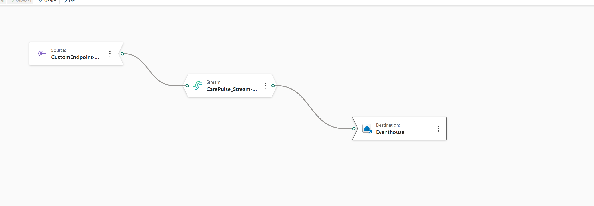
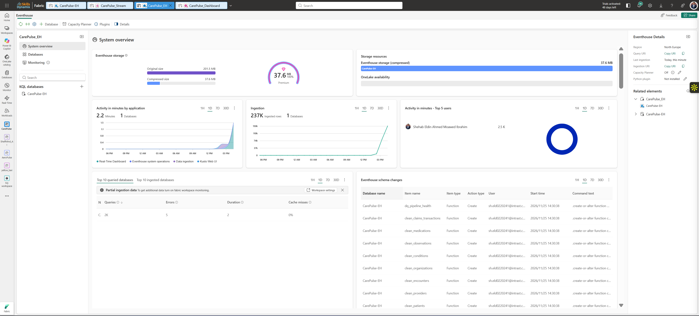
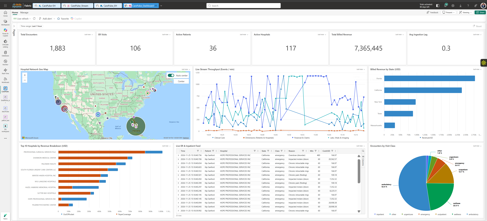
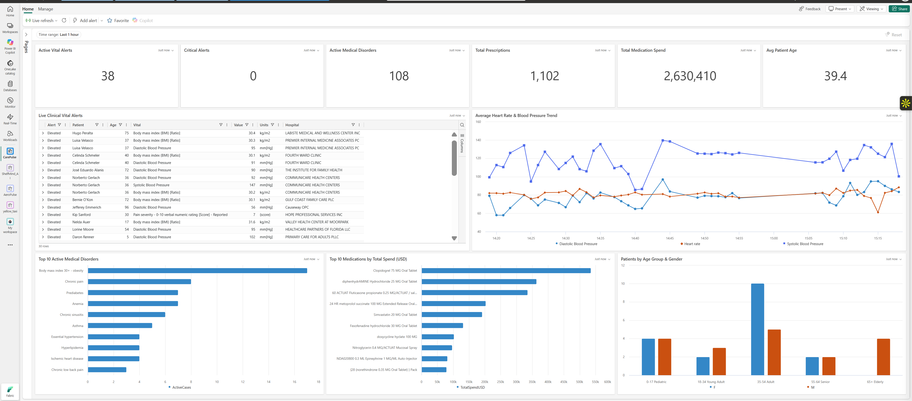

# CarePulse — Real-Time Healthcare Telemetry & Streaming Analytics

CarePulse is an end-to-end real-time healthcare data engineering platform that simulates clinical, operational, and financial telemetry across all **19 Synthea domains** in memory (without intermediate CSV files), streams events through **Apache Kafka / Microsoft Fabric Eventstream** into **Microsoft Fabric Eventhouse (KQL Database)** using a **Bronze → Silver → Gold Medallion architecture**, and powers a multi-page **Real-Time Dashboard** with live auto-refresh.

---

## Architecture Overview

```mermaid
flowchart LR
    JVM["Java In-Memory Runner<br/>SyntheaStreamRunner"] -->|NDJSON stdout| PROD["Python Producer<br/>python -m carepulse.producer"]
    PROD -->|"Mode A: --to-fabric"| ES["Microsoft Fabric Eventstream<br/>CarePulse_Stream Custom Endpoint"]
    PROD -->|"Mode B: Local Kafka"| KAFKA["Apache Kafka 3.8.0<br/>docker-compose.yml"]
    KAFKA -->|"19 topics + DLQ"| BRIDGE["Python Kafka Bridge<br/>python -m carepulse.bridge"]
    BRIDGE -->|"Wrapped payload JSON"| ES
    ES -->|Streaming Ingestion| BRONZE["Bronze Table<br/>synthea_raw dynamic"]
    BRONZE -->|"19 KQL Update Policies"| SILVER["19 Silver Tables + synthea_dlq<br/>kql/01_bronze_silver_setup.kql"]
    SILVER -->|"8 Cleaning & DQ Functions"| GOLD["Gold KQL Functions<br/>kql/02_gold_cleaning.kql"]
    GOLD -->|"Live _startTime / _endTime"| DASH["CarePulse_Dashboard<br/>kql/03_dashboard_queries.kql"]
```



<details>
<summary>Technical Component Flow (Mermaid Diagram)</summary>



</details>

### Pipeline Stages

1. **In-Memory Telemetry Generator ([java_bridge/SyntheaStreamRunner.java](java_bridge/SyntheaStreamRunner.java))**
   - Executes MITRE Synthea continuously in memory across rotated US states (`Massachusetts`, `California`, `Texas`, `New York`, `Florida`), emitting structured NDJSON lines directly to `stdout` while redirecting JVM progress logs to `stderr`.
2. **Real-Time Producer ([carepulse/producer.py](carepulse/producer.py))**
   - Validates and normalizes records using declarative schemas ([carepulse/schemas.py](carepulse/schemas.py)), attaches a 9-field streaming envelope (`event_id`, `event_type`, `event_time`, `clinical_time`, `batch_id`, `seq`, `sim_state`, `schema_version`, `source_system`), strips synthetic numeric suffixes from person names when `--clean-names` is enabled, routes malformed payloads to DLQ, and publishes either directly to **Fabric Eventstream** (`--to-fabric`) or to a local **Apache Kafka** cluster.
3. **Optional Local Kafka → Fabric Bridge ([carepulse/bridge.py](carepulse/bridge.py))**
   - Subscribes to all 19 `<prefix>.<table>` local Kafka topics (plus `<prefix>.dlq` with `--include-dlq`) and forwards records wrapped as `{"payload": ...}` into a single Fabric Eventstream custom endpoint topic.
4. **Fabric Eventhouse Medallion Layer ([kql/](kql/))**
   - **Bronze (`synthea_raw`)**: Streaming-enabled landing table receiving JSON payloads (`$.payload`).
   - **Silver (19 typed tables + `synthea_dlq`)**: Populated automatically at ingestion time via KQL update policies (`parse_<table>()` and `parse_synthea_dlq()`).
   - **Gold (9 KQL stored functions)**: Deduplicates entities (`arg_max`), strips numeric suffixes cleanly, calculates encounter lengths & out-of-pocket spend, flags abnormal vitals (`Normal`, `Elevated`, `Critical`), separates medical disorders from social determinants (SDOH), reconciles hospital revenue from encounters, and monitors pipeline latency/health via `dq_pipeline_health()`.

---

## Microsoft Fabric Live Showcase

### 1. Eventstream Ingestion Pipeline

Live ingestion topology in Fabric showing the `CustomEndpoint` Kafka/AMQP input flowing through `CarePulse_Stream` directly into the `Eventhouse` destination:



### 2. Eventhouse Storage, Compression & Schema (`CarePulse_EH`)

At capture time in **North Europe**, `CarePulse_EH` stored **237K ingested rows** with roughly **5.4x columnar compression** (`201.5 MB` original uncompressed size → `37.6 MB` compressed size) alongside automated Silver tables and Gold cleaning functions (`clean_patients`, `clean_encounters`, `clean_organizations`, `clean_conditions`, `clean_observations`, `clean_medications`, `clean_claims_transactions`, `dq_pipeline_health`):



### 3. Real-Time Dashboard — Page 1: Live Operations

Operational command center running in `Viewing` mode with **Live refresh** enabled (captured metrics: **1,883** Total Encounters, **106** ER Visits, **36** Active Patients, **117** Active Hospitals, **7,365,445 USD** Total Billed Revenue, **0.3 s** Avg Ingestion Lag):

- **KPI Row**: Total Encounters, ER Visits, Active Patients, Active Hospitals, Total Billed Revenue, Avg Ingestion Lag
- **Hospital Network Geo Map**: Encounter counts and revenue plotted across active US states
- **Live Stream Throughput (Events / min)**: Domain-level ingestion rate across Clinical Care, Dimensions, Financial & Claims, and Labs/Vitals/Imaging
- **Financial & Utilization Views**: Billed Revenue by State (USD), Top 10 Hospitals by Revenue Breakdown (Payer Coverage vs. Out-of-Pocket), Live ER & Inpatient Feed, and Encounters by Visit Class (`ambulatory` 52.4%, `wellness` 22.5%, `outpatient` 12.7%, `emergency` 5.6%, `urgentcare` 3.6%, `other` 1.8%)



### 4. Real-Time Dashboard — Page 2: Clinical Insights

Clinical monitoring view running in `Viewing` mode with **Live refresh** enabled (captured metrics: **38** Active Vital Alerts, **0** Critical Alerts, **108** Active Medical Disorders, **1,102** Total Prescriptions, **2,630,410 USD** Total Medication Spend, **39.4 yrs** Avg Patient Age):

- **KPI Row**: Active Vital Alerts, Critical Alerts, Active Medical Disorders, Total Prescriptions, Total Medication Spend, Avg Patient Age
- **Live Clinical Vital Alerts**: Deduplicated, pediatric-adjusted abnormal vitals joined with patient demographics and hospital name
- **Vitals Trend**: Timechart of Heart Rate (bpm), Systolic BP (mmHg), and Diastolic BP (mmHg)
- **Population & Prescribing Analytics**: Top 10 Active Medical Disorders (filtered from SDOH/administrative findings), Top 10 Medications by Total Spend (USD), and Patients by Age Group & Gender



### 5. Real-Time Dashboard — Page 3: Finance & Data Quality *(Queries Ready — Canvas Pending)*

The Page 3 tab (`Finance & Data Quality`) is currently an unpopulated placeholder in the dashboard workspace ([docs/images/finance-data-quality.png](docs/images/finance-data-quality.png) displays `"No tiles are defined for this page"`). All **10 queries** for Page 3 (`[Tile 12_KPI]` 6 Stat Cards + `[Tile 12]` Claims Cashflow, `[Tile 13]` Payers Covered vs. Uncovered, `[Tile 14]` `dq_pipeline_health()` Scorecard, `[Tile 15]` Dead Letter Queue Monitor) are prepared in [kql/03_dashboard_queries.kql](kql/03_dashboard_queries.kql) for pinning into the Page 3 canvas.

---

## Project Structure

```text
carepulse/
├── __init__.py                  # Package metadata
├── producer.py                  # Java-to-Kafka / Fabric Eventstream real-time producer CLI
├── bridge.py                    # Local 19-topic Kafka -> Fabric Eventstream forwarder CLI
├── schemas.py                   # 19-table schemas, name/vital cleaning, KQL generators
└── fabric_config.py             # .env loader & Eventstream SAS connection string parser

java_bridge/
└── SyntheaStreamRunner.java     # In-memory multi-state Synthea NDJSON stdout runner

kql/
├── 01_bronze_silver_setup.kql   # Bronze synthea_raw + 19 Silver tables + DLQ + update policies
├── 02_gold_cleaning.kql         # 8 Gold cleaning functions + dq_pipeline_health()
├── 03_dashboard_queries.kql     # Tile queries for Pages 1, 2, and 3 (Live Operations, Clinical, Finance/DQ)
└── direct_19_topics_setup.kql   # Alternative direct 19-topic Eventhouse table & JSON mapping setup

tests/
└── test_carepulse.py            # Schema, cleaning, routing, Fabric config, bridge & KQL tests

docs/images/                     # Architecture diagram & captured Fabric screenshots
docker-compose.yml               # Local Apache Kafka 3.8.0 broker (optional local mode)
requirements.txt                 # Python dependencies (confluent-kafka, python-dotenv)
.env.example                     # Fabric SAS connection template (secrets excluded via .gitignore)
synthea-stream-bridge.jar        # Compiled Java runner JAR (resolved from root or jars/)
synthea-with-dependencies.jar    # Synthea fat JAR (gitignored due to >100 MB size)
```

---

## Data Model Coverage

| Domain | Tables |
| --- | --- |
| **Dimensions & Coverage** | `patients`, `organizations`, `providers`, `payers`, `payer_transitions` |
| **Clinical Care** | `encounters`, `conditions`, `allergies`, `careplans`, `medications`, `procedures`, `immunizations` |
| **Labs, Vitals & Imaging** | `observations`, `imaging_studies`, `devices`, `supplies` |
| **Financial & Claims** | `claims`, `claims_transactions`, `patient_expenses` |
| **Ingestion & Reliability** | `synthea_raw` (Bronze JSON landing), `synthea_dlq` (Dead Letter Queue) |

---

## Quickstart

### Prerequisites

- **Python 3.10+** and packages from [requirements.txt](requirements.txt) (`pip install -r requirements.txt`)
- **Java JDK 17+** (`java.exe` available on `PATH` or default Eclipse Adoptium install)
- `synthea-with-dependencies.jar` and `synthea-stream-bridge.jar` in the workspace root (or inside a `jars/` folder)
- A **Microsoft Fabric** workspace with an **Eventstream** (`CustomEndpoint`) and **Eventhouse** KQL database

### 1. Configure Environment

Copy [.env.example](.env.example) to `.env` and fill in your Fabric Eventstream Custom Endpoint SAS connection string:

```env
FABRIC_CONNECTION_STRING=Endpoint=sb://<namespace>.servicebus.windows.net/;SharedAccessKeyName=<key_name>;SharedAccessKey=<key>;EntityPath=<topic_name>
FABRIC_TOPIC=<topic_name>
LOCAL_KAFKA_BOOTSTRAP=localhost:9092
TOPIC_PREFIX=synthea
```

### 2. Provision Fabric Eventhouse (Bronze, Silver & Gold)

Open your `CarePulse_EH` KQL Queryset in Microsoft Fabric and execute these scripts **in order**:

1. [kql/01_bronze_silver_setup.kql](kql/01_bronze_silver_setup.kql) — Creates Bronze `synthea_raw`, 19 typed Silver tables, `synthea_dlq`, and streaming update policies. *(Use [kql/direct_19_topics_setup.kql](kql/direct_19_topics_setup.kql) instead only if routing directly to 19 separate Kafka topics without a single Eventstream custom endpoint.)*
2. [kql/02_gold_cleaning.kql](kql/02_gold_cleaning.kql) — Creates `clean_patients()`, `clean_providers()`, `clean_encounters()`, `clean_organizations()`, `clean_conditions()`, `clean_observations()`, `clean_medications()`, `clean_claims_transactions()`, and `dq_pipeline_health()`.
3. [kql/03_dashboard_queries.kql](kql/03_dashboard_queries.kql) — Copy each tile query into your **CarePulse_Dashboard** pages (`Live Operations`, `Clinical Insights`, `Finance & Data Quality`) and enable **Auto refresh**.

### 3. Start Streaming

#### Direct to Microsoft Fabric Eventstream (Recommended)

```powershell
python -m carepulse.producer --to-fabric --clean-names --quiet-synthea --rate 25
```

Quick schema/JVM smoke test without sending data to Kafka or Fabric:

```powershell
python -m carepulse.producer --to-fabric --dry-run --quiet-synthea --rate 0 --batch-size 1 --max-batches 1 --limit 3
```

#### Local Kafka + Bridge Mode (Optional)

```powershell
# 1. Start local Apache Kafka broker
docker compose up -d

# 2. Produce 19 local synthea.* topics
python -m carepulse.producer --clean-names --quiet-synthea --rate 25

# 3. In another terminal, forward local Kafka topics to Fabric Eventstream
python -m carepulse.bridge --include-dlq
```

---

## Testing & Verification

Run the unit and KQL script validation suite from the repository root:

```powershell
python -m pytest -v
```
# carepulse-fabric-realtime-healthcare

